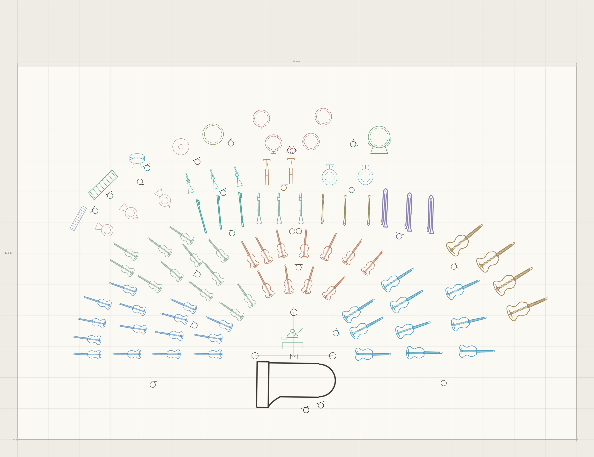
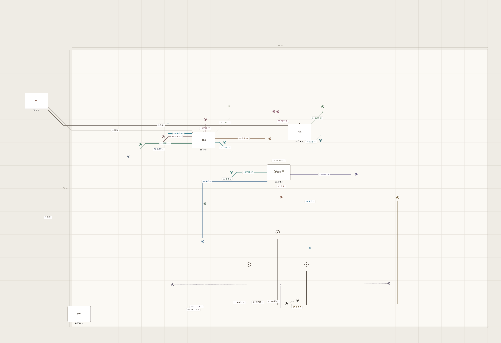
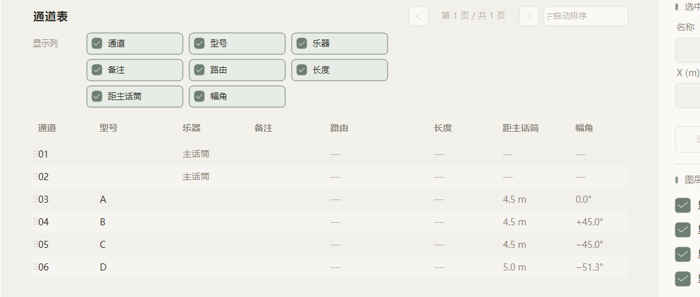

# Stage Micing · 舞台摆位

**中文** | [English](#english)

古典音乐会的「舞台摆位 + 话筒布局」设计工具 —— Windows / C++20 / Win32 / GDI+。

按真实米制摆好乐队、放好话筒、连好线，导出舞台图（PNG）与通道表（PDF）。
不需要联网，不依赖任何运行库。



---

## 下载

- **安装包（推荐）**：[`dist/StageMicing_Setup.exe`](dist/StageMicing_Setup.exe) —— 双击安装，免管理员权限，装到 `%LOCALAPPDATA%\StageMicing`，自动建快捷方式，可从「开始菜单」卸载。
- **开发版整包**（源码 + 构建树 + 工具 + 快照）：见 **Releases**。
- **说明书**：`manuals/`（中文 / English / Deutsch / Français）。

## 功能

- **五个页面**：项目信息 / 乐器摆位 / 话筒摆位 / 通道表 / 布线。
- **乐器 30 种**：弦乐、木管、铜管、打击乐、键盘（三角钢琴、立式钢琴、大键琴、钢片琴）、竖琴、声乐（独唱 / 合唱）、指挥、自定义；可改名、角度、位置，可单独指定颜色。
- **话筒**：主话筒（AB 对 / 强度差 / 混合差 / Decca 树，实时显示 SRA 录音角与射线）、点话筒、领夹话筒、强度差制式（XY / MS / Blumlein，一个对象两通道）、混合差制式（ORTF / NOS / DIN = 两支普通话筒摆好后绑定）。
- **38 个绑定目标**：具体乐器，以及环绕声道 / 天空声道 / 侧展 / 环境 / 弦乐组 / 木管组 / 铜管组 / 打击乐组。
- **通道表**：8 列（通道 / 型号 / 乐器 / 备注 / 路由 / 话筒线长度 / 距主话筒 / 幅角）；支持排序、翻页、行内编辑、拖动重排、路由列直接点选设备；表尾附「接口箱 → 声卡」布线汇总；可导出 PDF（超页自动分页）。
- **布线**：声卡 / 接口箱 / 无线接收器；实长与容量实时计算，超容量变红；编组话筒先汇聚再走一条主线；吊装线走向目标设备一侧的墙；线缆标签显示「通道号 + 话筒名」。
- **12 套内置预设**，全部来自真实工程，载入后恢复各自的原始舞台尺寸。
- **导出**：PNG 舞台图 / 布线图（2× / 4× / 8×，图幅含全部内容，左上角自动印项目信息）；PDF 通道表。
- 中 / 英 / 德 / 法四语界面；四位应用锁（锁定后只读）；关闭前提示保存。




## 预设

| 预设 | 舞台 (m) | 件数 |
|---|---|---|
| 三管编制·欧式 | 18×12 | 86 |
| 三管编制·美式 | 18×12 | 85 |
| 欧式钢琴协奏 | 18×12 | 87 |
| 美式钢琴协奏 | 18×12 | 86 |
| 古乐团 | 14×12 | 37 |
| 合唱乐团 | 18×16 | 154 |
| 合唱 + 钢琴 | 18×12 | 66 |
| 弦乐四重奏 1 / 2 | 9×7 | 4 / 4 |
| 钢琴三重奏 | 14×10 | 3 |
| 钢琴四重奏 | 14×10 | 4 |
| 钢琴独奏 | 14×12 | 1 |

## 从源码编译

```
cmake -S . -B build -G "Visual Studio 18 2026" -A x64
cmake --build build --config Release
```

产物：`build\Release\StageMicing.exe`。运行时 `assets\` 必须与 exe 同目录。

> 源码为 UTF-8 无 BOM：请勿用 PowerShell 的 `Get-Content/Set-Content` 改写（CP936 往返会破坏中文）。

## 目录

```
src/            源码（C++20 / Win32 / GDI+）
assets/         图标素材（运行时必需）
demo/           示例工程（12 套预设对应的原始工程 + test.smproj）
docs/           设计文档（STATUS / CABLING / BACKUP-RULES）
tools/          辅助脚本（素材生成、测量、打包）
dist/           发布物（安装包）
manuals/        四语使用说明书（zh / en / de / fr）
installation/   四语安装说明
FEATURES.txt     全部功能一览
INTRO.txt         产品简介
```

## 版本

**v1.0** —— 12 套预设（各自原始舞台尺寸）、距主话筒与幅角列、全局标签排版、40 色调色板、
应用锁、PNG 抬头与三档倍率、关闭前保存提示、路由列点选设备。

---

<a name="english"></a>
# Stage Micing · Stage Placement (English)

A planning tool for classical concert **stage layout and microphone placement** — Windows / C++20 / Win32 / GDI+.

Lay out the orchestra to scale, place microphones, wire them to stage boxes and the sound card,
then export a stage plot (PNG) and a channel list (PDF). No network, no external runtime.


## Download

- **Installer (recommended)**: [`dist/StageMicing_Setup.exe`](dist/StageMicing_Setup.exe) — double-click, no administrator rights, installs to `%LOCALAPPDATA%\StageMicing`, creates shortcuts, uninstall from the Start menu.
- **Developer package** (sources + build tree + tools + snapshots): see **Releases**.
- **Manuals**: `manuals/` (Chinese / English / Deutsch / Français).

## Features

- **Five pages**: Project info / Instruments / Microphones / Channel table / Cabling.
- **30 instruments**: strings, woodwinds, brass, percussion, keyboards (grand, upright, harpsichord, celesta), harp, voices (solo / choir), conductor, custom; each can be renamed, rotated, moved and given its own colour.
- **Microphones**: main mic (AB / intensity / mixed / Decca tree, live SRA display), point mic, lavalier, intensity techniques (XY / MS / Blumlein — one object, two channels), mixed techniques (ORTF / NOS / DIN — literally two plain mics placed and then bound).
- **38 binding targets**: individual instruments plus surround / height / side-fill / ambience / string group / woodwind group / brass group / percussion group.
- **Channel table**: 8 columns (channel, model, instrument, notes, route, mic-cable length, distance to main mic, azimuth); sorting, paging, inline editing, drag re-ordering, click-to-connect in the route column, a cabling summary block at the end, PDF export with automatic pagination.
- **Cabling**: sound cards / stage boxes / wireless receivers; real length and capacity computed live, over-capacity turns red; grouped mics converge first and share one trunk; flown runs go to the wall on the target's side; tags read `channel number + mic name`.
- **12 built-in presets**, all from real projects, each restoring its own original stage size.
- **Export**: PNG stage / wiring drawings (2× / 4× / 8×, full content, project info printed top-left) and PDF channel tables.
- Four UI languages (zh / en / de / fr); 4-digit app lock (read-only when locked); save prompt on close.


## Presets

| Preset | Stage (m) | Players |
|---|---|---|
| Triple wind · European | 18×12 | 86 |
| Triple wind · American | 18×12 | 85 |
| European piano concerto | 18×12 | 87 |
| American piano concerto | 18×12 | 86 |
| Chamber orchestra | 14×12 | 37 |
| Choir + orchestra | 18×16 | 154 |
| Choir + piano | 18×12 | 66 |
| String quartet 1 / 2 | 9×7 | 4 / 4 |
| Piano trio | 14×10 | 3 |
| Piano quartet | 14×10 | 4 |
| Piano solo | 14×12 | 1 |

## Build from source

```
cmake -S . -B build -G "Visual Studio 18 2026" -A x64
cmake --build build --config Release
```

Output: `build\Release\StageMicing.exe`. The `assets\` folder must sit next to the exe at runtime.

> Sources are UTF-8 without BOM. Never rewrite them with PowerShell `Get-Content/Set-Content` —
> a CP936 round-trip corrupts the Chinese text.

## Layout

```
src/            sources (C++20 / Win32 / GDI+)
assets/         icons (required at runtime)
demo/           sample projects (the 12 preset sources + test.smproj)
docs/           design notes (STATUS / CABLING / BACKUP-RULES)
tools/          helper scripts (asset generation, measuring, packaging)
dist/           release artefacts (installer)
manuals/        manuals in four languages
installation/   installation notes in four languages
FEATURES.txt     full feature list (Chinese)
INTRO.txt         product intro (Chinese)
```

## Version

**v1.0** — 12 presets with their original stage sizes, distance-to-main-mic and azimuth columns,
global label layout, 40-colour palette, app lock, PNG header with 2×/4×/8× export,
save prompt on close, click-to-connect in the route column.
